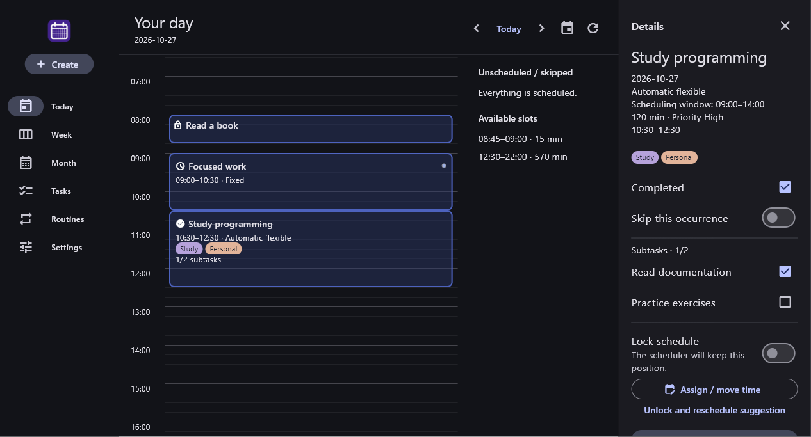
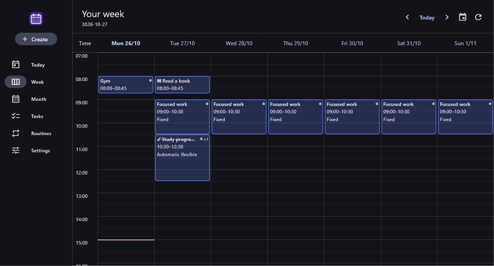

# Simple Calendar

[English](README.md) · [Español](docs/i18n/es/README.md)

A local Windows personal calendar combining fixed activities, automatic flexible scheduling and manually assigned tasks. No accounts, backend or Internet connection are needed during use. New installations start empty; example data exists only in tests.

Original project code and documentation use the [MIT License](LICENSE.md). Third-party components retain their own terms; see [third-party notices](THIRD_PARTY_NOTICES.md). Packaging includes both documents and exports the build's Flutter notices as readable THIRD_PARTY_NOTICES.txt. The separate icon-font notice is included as `licenses/MaterialIcons.txt`.

**Release status:** preparing **1.0.0-beta.1** for Windows x64. It has not been published and no public download is linked yet. Validate the final ZIP on clean Windows and check backup/update compatibility before distributing it.

## Preview

These captures come from the Windows integration test using an isolated temporary database and fictional tasks. They show the actual interface; new installations contain no sample agenda.





## Beta scope and limitations

The first beta covers local calendars, fixed/flexible/manual scheduling, recurring tasks, tags, completion and subtasks, English/Spanish, and JSON backup/restore. It does not include notifications, cross-day rescheduling, deadlines, task splitting, multiple availability intervals, synchronization or other operating systems.

The ZIP is unsigned and has no installer or automatic updater. Windows may show an unknown-publisher warning. Data is not encrypted. Clean-machine installation and distribution-to-distribution update checks remain required before publishing. Optional future features do not block this beta.

## Support and feedback

Once this repository is public, use its **Issues** tab for bugs and suggestions; it is the intended support channel, with no guaranteed response time. Include `1.0.0-beta.1` (build `1`), Windows version, steps to reproduce, and expected/actual behavior. Use fictional task names and redact screenshots. Do not upload your database, personal calendar or real backup. See [contributing](CONTRIBUTING.md).

## Languages

English is the default, including when older preferences have no language field. Choose **Settings → Language → Español** to switch to Spanish. The choice is saved locally and included in JSON backups. Theme and availability changes preserve it.

Language changes translate controls, dialogs and scheduling/storage messages. Task names, descriptions, subtasks and custom or renamed tags remain as entered. Untouched built-in tag labels follow the interface language; their stored names and IDs stay unchanged.

## Install and run

1. Extract the **entire** release ZIP into a permanent folder.
2. Open `SimpleCalendar.exe`. Keep its DLLs and `data` directory together.
3. Optionally create a shortcut to the executable.

Intended target: Windows 10/11 x64. The packaging script includes the Visual C++ runtime beside the app. A complete distribution is intended to require neither Flutter/Visual Studio nor administrator permissions. A clean-machine ZIP test remains a release gate; a development-machine build does not prove it.

The executable is currently unsigned. No MSI/MSIX installer or automatic updater exists. The binary distribution is portable, but its database lives in the user's application-support directory, **not beside the executable**.

## Usage

- **Create / Ctrl+N:** name, type, initial date, recurrence, weekly scope, priority, description, subtasks and tags. Fixed activities use **Start time / End time**; duration is calculated automatically. Flexible activities use an estimated duration, and manual tasks can remain unscheduled. Times can be typed as HH:mm or selected with the clock. The end must be later than the start on the same day; 24:00 is supported as the end of the day.
- **Today / Ctrl+T:** a 24-hour timeline, unscheduled activities, available slots and issues. Blocks shorter than 34 minutes retain their real time height and also appear in a short-block list.
- **Week:** seven columns share a vertical time scale and scroll position. Overlaps appear side by side; unscheduled, skipped and short activities have an additional list. Open a day through its header.
- **Month:** overview, navigation and opening dates. Tasks and Routines provide search and filters; their “today” filters use the current day regardless of the date previously browsed.
- **Details:** complete/skip an occurrence, check subtasks, edit and lock/unlock time. Completing an activity does not require every subtask to be checked.
- **Assign / move time:** choose an exact time or drag a flexible block within the same day in 15-minute steps. Manual placements lock and cannot silently replace protected blocks.
- **Edit:** change one occurrence or the definition from today. Changing scope reloads saved values and discards unsaved edits. General edits preserve historical/protected snapshots, progress and started activities.
- **Settings:** language, light/dark/system theme, one availability interval per weekday, tags and JSON backups. Equal start/end closes a day for flexible scheduling.

Automatic suggestions start on five-minute boundaries, preserve valid placements and use the first continuous slot that fits. A new high-priority task does not evict a valid existing suggestion. Started, fixed, manual and locked blocks are protected. Without a long enough slot, the occurrence remains visible without a time and with an issue. The scheduler does not split tasks or move work across days.

**Remove activity** asks for confirmation and permanently removes the activity from the calendar from today, including today. Removed dates disappear from timelines and skipped lists and cannot be reactivated by editing, assigning a time or toggling Skip. Earlier dates remain accessible. Original execution records, assignments, locks and progress are retained in backups without being rewritten as skipped. Previous archived removals are converted automatically on upgrade. This is distinct from **Skip this occurrence**, which remains reversible.

**Weekly scope:** new editor activities default to Weekly. Select **Every week** for an ongoing routine or **This week only** to stop on the Sunday of the start date's Monday?Sunday week. The Repeat field controls the day pattern (daily, weekdays, weekly or selected weekdays); Once is still available for a single date. Changing the start date moves the one-week limit with it. Existing saved/protected history is preserved when editing definitions.

Identical subtask names preserve checks by order of appearance. Supported dates: January 1, 2000 through December 31, 2100. Blocks cannot cross midnight.

### Tags

Use **Tags → Choose** in the editor to select several optional tags, search or create a custom tag. Built-ins are Work, Study, Training, Personal, Home, Health, Leisure and Other. Tags do not influence scheduling.

Settings supports renaming/recoloring tags and retiring custom tags after confirmation. Built-ins cannot be retired. Retirement preserves associations/history and reserves the name. There is no reactivation/purge UI. Membership belongs to each snapshot; names/colors are global catalogue metadata. Renaming changes the display of historical associations too.

Tasks/Routines filter by one tag or Untagged, alongside search/type/status. Calendars show compact indicators; details show all names. There are no calendar tag filters or hierarchies.

## Data and backups

SQLite is stored at `%APPDATA%\Simple Calendar\calendar.sqlite`. The application uses the Windows roaming-data root and a stable folder name, independent of executable location, native company/product metadata and interface language. Moving binaries does not move the database.

On the first launch with this storage layout, if the new database is absent, an existing `%APPDATA%\local.calendario\calendario\calendario.sqlite` is migrated automatically. SQLite creates a consistent snapshot including committed WAL data; a temporary copy is checked before promotion. The old database is retained unchanged as a fallback copy. An existing new database always takes precedence and is never overwritten with legacy data. Migration failures stop startup instead of silently opening an empty agenda. A small `.migration.lock` file coordinates migration attempts.

After verifying the new agenda and exporting a JSON backup, the old folder can be archived manually. Do not keep using an older executable: it writes to the old location, and later edits there are not merged into the new database. Export before updating. This covers the existing unpackaged Windows layout; Microsoft Store storage/identity transitions require separate validation.

Changes save automatically. A second launch focuses the existing window in the same Windows session. An unreadable/incompatible database is never automatically deleted/recreated.

Export JSON from Settings. Import validates format/version, dates, ranges, IDs, duplicates, relationships, revisions, tags and preferences before confirmation and transactional replacement. Limit: 50 MB. Import **replaces**, rather than merges, the agenda. JSON and SQLite are not encrypted by the application.

### Update safely

1. Export a backup outside the application folder and keep it.
2. Close the app. Extract the whole new ZIP into a different folder and keep the previous binaries.
3. Open the new version and check completed occurrences, subtasks, locked assignments, tags, language and availability.
4. Never open a newer database with an older binary that does not understand its schema. Keep the pre-update backup too.

SQLite schema is **v5**, with transactional v1/v2/v3/v4 upgrades. Table layout is unchanged from v3; newer contracts protect recurrence bounds, removal markers and automatic scheduling windows from older writers. Legacy pre-v4 archived definitions receive a removal cutoff from their archival revision; execution history is retained. JSON format is `calendario-local` **v4**, with v1/v2/v3 import. Older binaries must not open this database or restore newer backups. Export a backup before updating and retain compatible binaries for recovery. Missing optional language still defaults to English.

Automatic flexible activities optionally offer **Limit scheduling hours**, with **Not before** and **Finish by** times (for example 09:00–14:00). Their full duration must fit within both this same-day window and daily availability. No suitable continuous slot means an unscheduled activity with a warning. Existing activities remain unrestricted unless you enable this option. Locked or already-started blocks keep their position and show warnings if outside the window.

Temporary database/reopen/migration/restore tests do not replace a real A→B distribution update on clean Windows.

### Storage errors and recovery

- **Not enough space:** free space and retry. Page-limit tests do not simulate power failure or every disk fault.
- **Read-only/access denied:** check folder/file permissions; do not routinely run as administrator.
- **Busy database:** close other instances and retry; do not delete SQLite sidecars to unlock it.
- **Incompatible version:** use a compatible binary; never edit `user_version` to force opening.
- **Unreadable/corrupt database:** close the app and preserve the entire data directory before recovery.

If the app opens, export its state before restoring. Invalid backups are rejected before replacement; failed restore transactions preserve the previous state.

If it cannot open and you have a valid JSON backup, close all instances and copy **the whole support directory**, including SQLite sidecars, to a safe location. Only after preserving the original, move the damaged directory aside without deleting it; open an empty database and import the backup. Check the result. This recovers the backup's state, not later changes. Resolve permissions/version issues first: a new folder does not repair them.

Without a valid backup, keep originals and investigate only duplicates. Never edit your sole database or import unknown files as a repair attempt. Physical corruption recovery is not guaranteed. Store data migration remains a separate future validation.

## Development

The public product name is **Simple Calendar**, the Dart package is `simple_calendar`, and the Windows executable is `SimpleCalendar.exe`. Legacy storage paths, the `calendario-local` backup-format identifier and the Windows single-instance mutex retain their old identifiers solely for compatibility. They are not user-visible product names. Do not replace those strings without a compatibility migration.

The approved purple calendar logo is `assets/branding/app_icon.png`, used in the app navigation. Windows embeds `windows/runner/resources/app_icon.ico` for the executable/window icon. To regenerate its 16–256 px sizes from the PNG, run `powershell -NoProfile -File .\scripts\update_windows_icon.ps1` on Windows, then rebuild. This export uses Windows PowerShell/System.Drawing and does not require an extra package. Windows Explorer may retain a cached icon for an older executable or shortcut.

Verified: **Flutter 3.41.4 / Dart 3.11.1**, Visual Studio 2022 with Desktop development with C++ and Windows SDK. Drift/drift_dev **2.33.0** are pinned for compatibility; Riverpod resolves to **2.6.1**. Preserve `pubspec.lock`.

In PowerShell:

```powershell
flutter pub get
dart run build_runner build
flutter run -d windows
```

Checks:

```powershell
flutter analyze
flutter test
flutter test integration_test/windows_test.dart -d windows
flutter build windows --release
```

Native tests use a temporary database, never the normal user store. Do not terminate a user's instance for testing without agreement.

Release executable: `build/windows/x64/runner/Release/SimpleCalendar.exe`. Packaging:

```powershell
.\scripts\package_windows.ps1
```

The script reads `version` from `pubspec.yaml` and produces:

- `dist/SimpleCalendar-1.0.0-beta.1-windows-x64.zip`
- `dist/SimpleCalendar-1.0.0-beta.1-windows-x64.zip.sha256`

It requires Visual Studio, stages runtime files and public documentation in a fresh directory, includes translations/screenshots, and copies this README as `LEEME.md`. Old build notes and editor settings are excluded. `-SkipBuild` checks the executable's product version against `pubspec.yaml`; matching versions do not establish matching source or a clean build. Rebuild for the final release. The ZIP is not guaranteed byte-for-byte reproducible.

To verify a downloaded ZIP, compare the hash below with the first field in its `.sha256` file:

```powershell
Get-FileHash .\SimpleCalendar-1.0.0-beta.1-windows-x64.zip -Algorithm SHA256
```

Publish both files together when creating the GitHub pre-release tagged `v1.0.0-beta.1`, after the release checks. The checksum detects changed bytes; it is not a digital signature. Advance the prerelease number for subsequent betas and increase the build number for each distributed build. Do not replace an already published artifact under the same version. Tool/package downloads need Internet during development setup; normal use does not.

See [architecture](ARCHITECTURE.md) and [contributing](CONTRIBUTING.md). Code comments and primary Markdown use English. Human translations live under `docs/i18n/<language-code>/`; AGENTS.md remains one authoritative English document.
